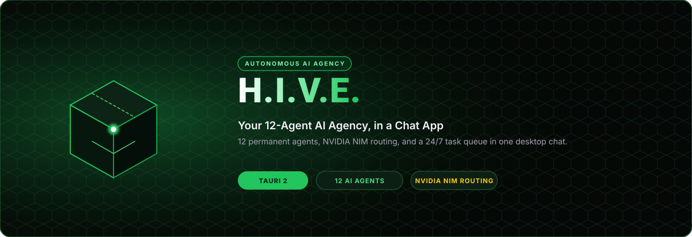
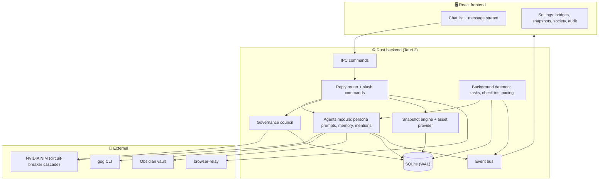

<div align="center">



<br/>

[](https://tauri.app/)
[](https://www.rust-lang.org/)
[](https://react.dev/)
[](https://build.nvidia.com/)
[](#)

# H.I.V.E. — Your 12-Agent AI Agency, in a Chat App

**A lightweight WhatsApp-style desktop app where 12 permanent AI agents work for you, talk to each other, and keep a running task queue 24/7.**

[Overview](#-overview) • [Quick Start](#-quick-start) • [Using It](#-using-it) • [Agents](#-the-12-agents) • [Architecture](#%EF%B8%8F-architecture) • [Configuration](#%EF%B8%8F-configuration) • [Development](#-development)

</div>

---

## 🌌 Overview

H.I.V.E. is a Tauri 2 desktop app with a Rust backend and a React frontend.

- 💬 **One group chat + 12 DMs.** `#agency-hq` is the team room; every agent also has a direct line.
- 🧠 **Agents with real personalities.** Each one has its own model tier, skills, tools and memories, and they all follow the casual house style in [AGENTS.md](AGENTS.md).
- ⏱️ **5-minute task chunking.** Goals are broken into small steps that agents work through in the background, posting progress as they go.
- 🔌 **Real local bridges.** Google via the `gog` CLI, an Obsidian vault, the OpenCode Chrome relay and Windows speech, each reporting its real status.
- 🗳️ **Governance.** A weighted council votes on big decisions, and anything owner-controlled waits for you.
- 🛡️ **Blue/green UI snapshots.** The running UI bundle is snapshotted, hashed and checked against the [Application Constitution](app/constitution.json), and you can roll back instantly.
- 🔇 **Quiet by default.** Audio is muted, and speech only plays when you click.

---

## ⚡ Quick Start

### Prerequisites

| Need | Why |
|---|---|
| Windows 10/11 with WebView2 | Desktop runtime (ships with Windows 11) |
| [Node.js 20+](https://nodejs.org/) | Frontend build |
| [Rust (stable)](https://rustup.rs/) | Backend build |
| `NVIDIA_API_KEY` | Agents talk through [NVIDIA NIM](https://build.nvidia.com/). Without it, agents tell you they can't reach their models. |
| *Optional:* `gog` CLI | Google Calendar, Drive, Gmail and Tasks for `/gog` and @LINK |
| *Optional:* `browser-relay` | `/browser` commands |

Set the key once (PowerShell):

```powershell
setx NVIDIA_API_KEY "nvapi-..."
```

### Run it

```bash
npm ci
```

```bash
hive doctor
```

```bash
hive dev
```

`hive` is a small wrapper (`hive.cmd` → `scripts/hive.ps1`). `hive build` produces installers, `hive launch` starts the last build, and `hive test` runs every check.

On first launch the agents check in on `#agency-hq`, an 8-project starter portfolio is queued, and PRIME posts a first briefing based on what actually worked. Type `/activate` to run that again later.

---

## 💻 Using It

Just talk. In `#agency-hq`, tag up to three agents (`@FORGE @SENTINEL thoughts?`) and they answer in order, building on each other. With no tag, PRIME answers. In a DM, that agent answers.

| Command | What it does |
|---|---|
| `/help` | List commands |
| `/task <goal>` | @CONDUCTOR breaks it into ~5-minute steps and assigns an owner |
| `/gog <args>` | Run the Google CLI, e.g. `/gog calendar calendars` |
| `/obsidian <title> \| <note>` | Save a note to the vault (`/obsidian <words>` searches it) |
| `/browser <status\|tabs>` | Query the Chrome relay |
| `/debate <proposal>` | The council votes in parallel. Unreachable members abstain, and without quorum the result is `inconclusive` |
| `/spawn_temp <name>` | Temporary `temp_` specialist with a 30-minute TTL |
| `/deploy [version] [summary]` | Snapshot and activate the running UI bundle |
| `/rollback` | Switch to the previous verified snapshot and reload |
| `/backup` | SQLite snapshot now |
| `/pause` · `/resume` | Stop or restart background work |

**Shortcuts:** `Ctrl+Shift+H` show/hide window · `Ctrl+K` search · `Ctrl+F11` focus mode. Closing the window hides it to the tray; the agency keeps running.

---

## 🤖 The 12 Agents

Definitions live in [`agents/`](agents) and are re-synced into the database on every launch.

| Agent | Role | Model tier |
|---|---|---|
| **PRIME** | Command / Strategy | `nvidia/nemotron-3-ultra-550b-a55b` |
| **SAGE** | Research & Analysis | `nvidia/nemotron-3.5-super-vl-120b-a12b` |
| **FORGE** | Engineering / Build | `nvidia/nemotron-3.5-lightning-30b-a3b` |
| **SENTINEL** | Security & Audit | `mistralai/mistral-large-4-1t-a52b` |
| **VOICE** | Communications | `nvidia/nemotron-3-nano-omni-30b-a3b-reasoning` |
| **ARCHIVIST** | Knowledge & Memory | `openai/gpt-oss-20b` |
| **CONDUCTOR** | Operations / Queue | `minimaxai/minimax-m3.1-flash` |
| **VISION** | Creative / Design | `nvidia/nemotron-3.5-super-vl-120b-a12b` |
| **LEDGER** | Finance / Resources | `nvidia/nemotron-3-ultra-550b-a55b` |
| **LINK** | Integration / Tools | `mistralai/mistral-large-4-1t-a52b` |
| **GAUGE** | Quality / Verification | `nvidia/nemotron-3.5-lightning-30b-a3b` |
| **SPARK** | Innovation / Experiments | `nvidia/nemotron-3.5-bolt-e4b` |

Full schema, communication style and runtime behavior: [AGENTS.md](AGENTS.md).

---

## 🗺️ Architecture



**NIM cascade:** each call starts with the agent's own model tier and falls back through the roster, trying at most 4 models within a 100-second budget. A model that gets rate-limited, goes down or returns 404 cools down for 2, 5 or 30 minutes. A rejected API key fails immediately instead of retrying every model.

**Background pacing:** turns run every 20 seconds while you're active, slow down 4x after 10 idle minutes and 12x after an hour, back off on failures, and pause while you're chatting.

---

## ⚙️ Configuration

| Setting | Where | Default |
|---|---|---|
| `NVIDIA_API_KEY` / `NIM_API_KEY` | Environment (process, user or machine) | none |
| `GOG_CLI_PATH` | Environment | `~/gog-wrapper/gog.bat`, `~/go/bin/gog.exe`, then `gog` on PATH |
| `HIVE_OBSIDIAN_VAULT` | Environment | `~/Documents/HIVE-Vault` |
| `daemon_interval_secs` | `app_settings` table | `20` |
| Font, font size, mute | Settings → Accessibility (persisted) | Segoe, 14px, muted |

**Data** lives in `%APPDATA%\Lushapps\HIVE\`:

```text
data/hive.db           SQLite database (WAL)
backups/hive_<date>.db daily snapshot (+ /backup)
frontend/versions/     UI bundle snapshots with manifests
attachments/           content-addressed uploads
cache/audio/           synthesized speech
```

---

## 🧪 Development

```bash
hive test
```

That runs the Constitution validator, TypeScript and the Vite build, then `cargo test`. You can also run them separately:

```bash
npm test
```

```bash
cargo test --manifest-path src-tauri/Cargo.toml
```

On Linux, building the backend needs the WebKitGTK dev packages (`libwebkit2gtk-4.1-dev`, `libgtk-3-dev`, `libayatana-appindicator3-dev`, `librsvg2-dev`).

### Project layout

```text
agents/                  12 agent definitions (JSON)
app/constitution.json    immutable product invariants
docs/                    design spec and implementation plan
public/                  static assets
scripts/                 hive CLI + constitution validator
src/                     React frontend
src-tauri/
  src/agents/            persona prompts, mentions, transcripts, replies
  src/bridges/           NIM router, gog, Obsidian, browser relay, speech
  src/daemon/            background task + chat loop
  src/db/                SQLite schema, migrations, queries
  src/deployment/        bundle snapshots, validator, asset provider
  src/governance/        council votes and owner gates
  tests/                 integration tests
```

---

<div align="center">
  <p>Crafted with 💖 by <b>snapwave//Lushapps</b></p>
</div>
