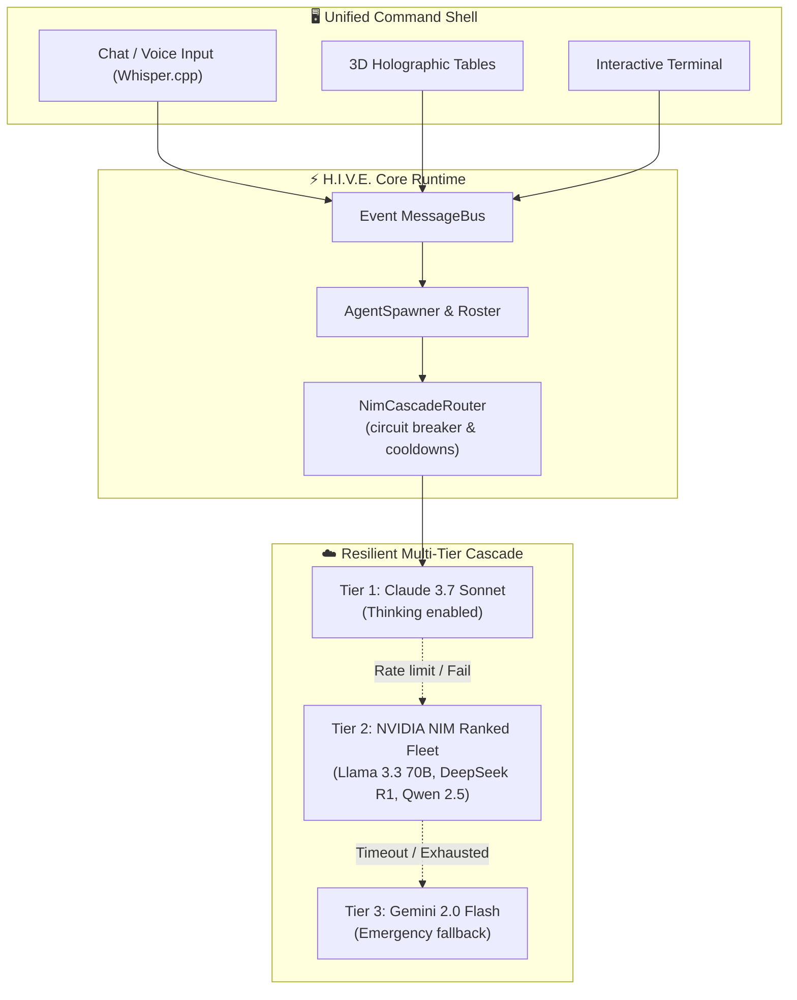

<div align="center">


<br/>

[](https://unity.com/)
[](https://unity.com/srp/universal-render-pipeline)
[](https://www.nvidia.com/en-us/ai-data-science/products/nim/)
[](#-12-persistent-agents)
[](#)

<br/>

# H.I.V.E. — Borg Cube Autonomous AI Agency Headquarters

**An immersive 3D cybernetic headquarters for a 12-agent autonomous AI agency built in Unity with resilient NVIDIA NIM cascade routing.**

<br/>

[Overview](#-overview) • [Quick Start](#-quick-start) • [Architecture](#-architecture--nim-cascade-router) • [3D Environments](#-3d-headquarters-7-zones) • [Command Interface](#-command-interface) • [Configuration](#-configuration)

</div>

---

## 📑 Table of Contents

- [🌌 Overview](#-overview)
- [⚡ Quick Start](#-quick-start)
  - [Prerequisites](#prerequisites)
  - [Installation & First Run](#installation--first-run)
- [🗺️ Architecture & NIM Cascade Router](#-architecture--nim-cascade-router)
- [🤖 12 Persistent Agents](#-12-persistent-agents)
- [🏢 3D Headquarters (7 Zones)](#-3d-headquarters-7-zones)
- [💻 Command Interface](#-command-interface)
- [⚙️ Configuration & Environment](#-configuration--environment)
- [📁 Project Layout](#-project-layout)
- [📄 License & Credits](#-license--credits)

---

## 🌌 Overview

**H.I.V.E.** (*Hierarchical Intelligence Virtual Environment*) is an autonomous operations headquarters inside a navigable, Borg-inspired cybernetic megastructure. 

Key architectural pillars:
- **Immersive 3D Cybernetic Megastructure:** 7 specialized operational zones (Command Chamber, Atrium, Collab Chamber, Knowledge Archive, Infrastructure).
- **12 Persistent Autonomous Agents:** Each agent maintains dedicated workspace geometry, episodic memory indexes, personality attributes, and tool sets.
- **NIM Cascade Fallback Router:** Automatic fallback pipeline (`Claude` → `NVIDIA NIM Free Tier` → `Gemini`) with circuit breakers, auto-reordering of slow endpoints, and token optimization.
- **Unified Multimodal Command Shell:** Drive agents using text chat, interactive terminals, push-to-talk voice (Whisper + Piper TTS), file attachments, or holographic 3D widgets.
- **Cognitive Density Modes:** Toggle between `Dense` (power monitoring), `Comfortable` (balanced), and `Focus` (ADHD-friendly UI filtering).

---

## ⚡ Quick Start

### Prerequisites

1. **Unity 2022.3 LTS or 2023.2+** with Universal Render Pipeline (URP) and .NET Standard 2.1.
2. **API Keys** (set as environment variables):
   ```bash
   ANTHROPIC_API_KEY=your_claude_key
   NVIDIA_API_KEY=your_nim_key
   GEMINI_API_KEY=your_gemini_key  # Optional fallback tier
   ```
3. **Git LFS** (for large 3D meshes, textures, and audio assets).

### Installation & First Run

```bash
# Clone the repository
git clone https://github.com/Snapwave333/hive-unity.git

# Open Unity Hub -> Add Project -> Select the H.I.V.E folder
```

1. In the Project window, open `Assets/Scenes/CommandChamber.unity`.
2. Press **Play Mode** in the Unity Editor.
3. Tap **`~`** (tilde) to toggle the Command Input overlay.
4. Execute:
   ```text
   @PRIME status
   ```
   The request routes through the live NIM cascade and streams a response from agency leadership.

---

## 🗺️ Architecture & NIM Cascade Router



### Circuit Breakers & Cooldown Engine
- **429 Rate Limits:** Honors HTTP `Retry-After` headers automatically.
- **5xx Outages:** Applies escalating cooldowns (2 min → 10 min → 30 min).
- **Latency Deprioritization:** Calls exceeding 90 seconds are automatically shifted to the back of the cascade for 30 minutes.
- **Persistent State:** Network health is journaled to `~/.hive/llm_state.json`.

---

## 🤖 12 Persistent Agents

| Code | Role | Domain & Skills | Workspace Prefab |
|---|---|---|---|
| **@PRIME** | Agency Director | Mission planning, delegation, budget & approval gates | `Workspace_PRIME.prefab` |
| **@ARCHON** | System Architect | Tech stack design, API contracts, infrastructure | `Workspace_ARCHON.prefab` |
| **@SCRIBE** | Documentation & PR | Technical writing, changelogs, public releases | `Workspace_SCRIBE.prefab` |
| **@SENTINEL**| Security & Auditing | Permission auditing, credential vault, security | `Workspace_SENTINEL.prefab` |
| **@FORGE** | Build & Devops | CI/CD pipelines, package deployment, containerization | `Workspace_FORGE.prefab` |
| **@CIPHER** | Data & Knowledge | Vector memory index, SQLite storage, graph search | `Workspace_CIPHER.prefab` |
| *+6 Specialized* | Agents | UI/UX, QA, Audio/Voice, Outreach, Media, Analytics | Custom agent workspaces |

> Full JSON agent schemas and tool permissions are documented in [AGENTS.md](AGENTS.md).

---

## 🏢 3D Headquarters (7 Zones)

| Scene | Purpose & Key Geometry |
|---|---|
| **`CommandChamber.unity`** | Central hexagonal operations hub; holographic overview table, agency monitors, and owner throne. |
| **`Workspace_[Agent].unity`** | 12 dedicated cubicles with role-appropriate cybernetic terminals and personal memory vaults. |
| **`CollabChamber.unity`** | Multi-agent synthesis chamber with collaborative holographic projection boards. |
| **`KnowledgeArchive.unity`** | Navigable 3D memory bank visualizing embeddings as glowing green datastacks. |
| **`Infrastructure.unity`** | Real-time diagnostic room rendering active model breakers, network queues, and token gauges. |
| **`OwnerControl.unity`** | Master control panel with physical biometric authorization switches and emergency kill levers. |
| **`Atrium.unity`** | High-ceiling transit concourse linking all 6 outer wings. |

---

## 💻 Command Interface

Access the agency command line by pressing **`~`** (tilde) or clicking the bottom-right HUD prompt:

```text
@PRIME analyze logs              # Direct instruction to specific agent
/project "FCC Serenity Studio"   # Switch context to an active project
task #128 status                 # Query specific sub-task execution
/terminal                        # Open full-screen ANSI terminal
/voice                           # Engage push-to-talk voice interface
attach logs/error.log            # Attach local project file into context
```

---

## ⚙️ Configuration & Environment

### `Assets/StreamingAssets/config.json`

```json
{
  "llm": {
    "gemini_fallback": false
  },
  "hive": {
    "agent_count": 12,
    "density_mode": "comfortable",
    "animation_level": "full",
    "focus_mode_enabled": true,
    "daily_briefing_time": "08:00"
  }
}
```

---

## 📁 Project Layout

```text
H.I.V.E/
├── assets/                  # Hero banner and brand assets
│   └── hive-banner.svg      # 1280×440 Borg cybernetic banner
├── Assets/
│   ├── Runtime/             # Production C# assemblies
│   │   ├── Core/            # MessageBus, Repository, Logger
│   │   ├── LLM/             # NimCascadeRouter & circuit breakers
│   │   ├── Agents/          # AgentSpawner & RelationshipGraph
│   │   ├── Memory/          # Local JSONL & vector embeddings
│   │   └── UI/              # Cybernetic panels, HUD widgets, CommandInput
│   ├── Editor/ModelLab/     # Model benchmark & cascade ranker window
│   ├── StreamingAssets/     # cascade.json, config.json, and agent schemas
│   ├── Scenes/              # 7 HQ operational unity scenes
│   └── Prefabs/             # 12 agent cubicles and architectural modular kit
└── AGENTS.md                # Full agent roster specifications
```

---

## 📄 License & Credits

- Proprietary internal architecture for Snapwave Creative Labs.
- NIM Cascade Router adapted from StickExplainers `stickfx/llm.py`.
- Borg aesthetic inspired by *Star Trek* (original clean-room IP implementation).

<div align="center">
  <br/>
  <p>Crafted with 💖 by <b>snapwave//Lushapps</b></p>
</div>
