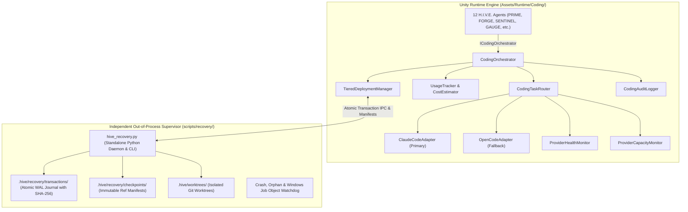
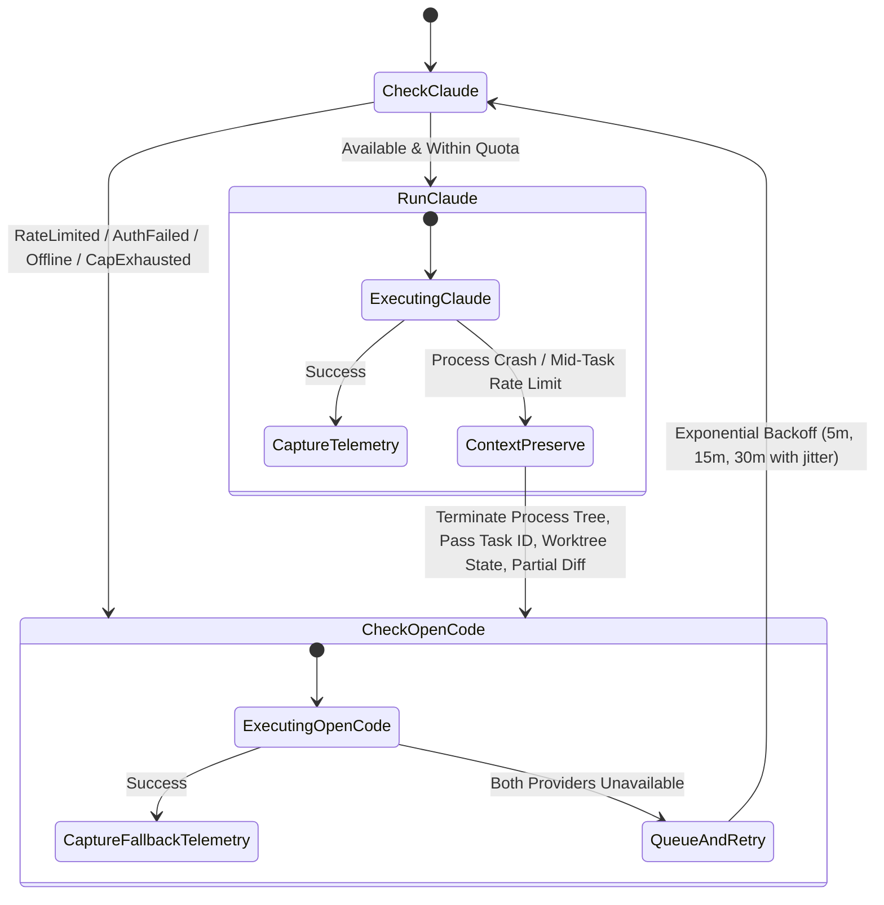
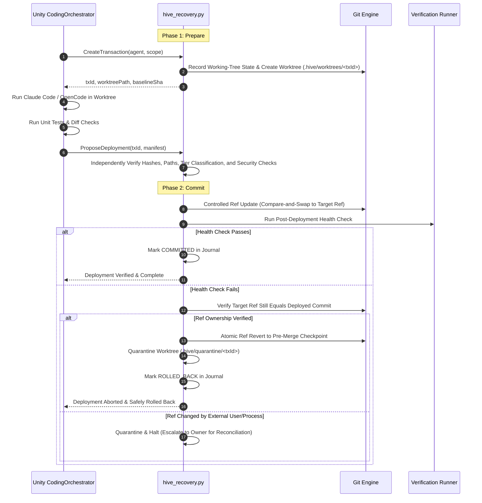

# Technical Specification: Claude Code + OpenCode Autonomous Development System

**Document Version:** 1.1.0 (Authoritative & Verified)  
**Date:** 2026-10-31  
**Author:** Snapwave//Lushapps (Pair Programmed with Antigravity)  
**Status:** Approved for Implementation  
**Target Environment:** Unity 6000.6.7f1 LTS (URP) / .NET Standard 2.1 / Windows 64-bit  

---

## 1. Executive Summary & Objective

The **Claude Code + OpenCode Autonomous Development System** establishes a dedicated, enterprise-grade Coding Orchestration Layer for the 12 permanent agents of H.I.V.E. It enables the agency to autonomously inspect, debug, optimize, test, document, and extend its own source code, skills, and assets.

The system employs **Claude Code CLI** as its primary development engine and **OpenCode CLI** as its automatic free fallback. It enforces a strict **Tiered Autonomy Deployment Policy** backed by an **Out-of-Process Recovery Supervisor** running independently of Unity in standalone Python.

Crucially, the recovery mechanism operates strictly outside the agency's self-modifying boundary: H.I.V.E. can rewrite its own application, coding adapters, agent skills, and orchestration systems, but cannot rewrite, compromise, or disable the mechanism that independently protects and restores those systems.

---

## 2. System Architecture & Boundaries

The architecture maintains an absolute separation of concerns across two distinct execution planes:



### 2.1 Component Responsibilities

| Component | Execution Plane | Responsibilities |
| :--- | :--- | :--- |
| `ICodingOrchestrator` / `CodingOrchestrator` | Unity Runtime | Unified entry point for all 12 agents; task queueing, state persistence, lifecycle management, task resumption. |
| `CodingTaskRouter` | Unity Runtime | Evaluates provider availability, dispatches tasks, manages clean mid-task context handoff on failover. |
| `ClaudeCodeAdapter` | Unity Runtime | Wraps `claude.exe` CLI; streams stdout, extracts structured JSON telemetry, classifies exits and rate limits. |
| `OpenCodeAdapter` | Unity Runtime | Wraps `opencode` CLI; selects verified free models under configured policy; handles prompt translation. |
| `ProviderHealthMonitor` | Unity Runtime | Tracks provider states: `Available`, `Unavailable`, `RateLimited`, `AuthFailed`, `UsageExhausted`, `Recovering`, `Disabled`. Distinguishes temporary vs permanent faults. |
| `UsageTracker` & `CostEstimator` | Unity Runtime | Tracks input, output, cached tokens, and USD costs. Strictly separates measured telemetry from heuristic estimates. |
| `TieredDeploymentManager` | Unity Runtime | Evaluates touched paths; classifies transactions into Tier 1 (Auto), Tier 2 (Owner Gated), or Tier 3 (Prohibited). |
| `CodingAuditLogger` | Unity Runtime | Streams audit records to `MessageBus`, `Repository`, and immutable local logs. |
| `hive_recovery.py` / `hive_recovery.cmd` | External Supervisor | Independent Python script and Windows background watchdog. Creates isolated Git worktrees, records SHA-256 manifests, executes atomic compare-and-swap ref updates, monitors process trees via Windows Job Objects, and guarantees rollback without depending on Unity. |

---

## 3. Tiered Autonomy Deployment Policy

The system classifies every modification based on a strict **fail-closed** path policy. The recovery supervisor independently calculates path classifications from `git diff-tree` and canonical filesystem resolution (symlink and traversal safe) — it never trusts the caller's claimed tier.

### 3.1 Policy Matrix

| Tier | Name | Target Paths & Criteria | Deployment Rules |
| :--- | :--- | :--- | :--- |
| **Tier 1** | **Autonomous Deployment** | • `Assets/Runtime/UI/Styles/**`<br>• `Assets/Runtime/Skills/**` (non-privileged)<br>• `Assets/Runtime/Voice/**`<br>• `docs/**`<br>• `README.md`<br>• `tests/**` (routine unit fixtures) | Auto-merges and deploys only when:<br>1. Isolated worktree tests pass 100%.<br>2. Explicit baseline test inventory is matched (no skipped/disabled tests).<br>3. Static security diff check passes (SENTINEL).<br>4. Deployment health checks succeed. |
| **Tier 2** | **Owner Approval Required** | • `Assets/Runtime/Core/**`<br>• `Assets/Runtime/Coding/**`<br>• `Assets/Runtime/Security/**`<br>• `Assets/Runtime/Persistence/**`<br>• `Assets/Runtime/LLM/**`<br>• `Assets/Scenes/**`<br>• `ProjectSettings/**`<br>• `Packages/manifest.json`<br>• `.github/workflows/**`<br>• Agent permission schemas<br>• *Any unknown or unclassified path* | 1. Prepared in isolated worktree.<br>2. Tests pass and diff report is generated.<br>3. Transaction placed in `STAGED_AWAITING_APPROVAL`.<br>4. **Owner-Only Authorization**: Requires explicit Owner signature bound to the exact `txId`, candidate commit hash, and manifest SHA-256. PRIME or other agents cannot authorize deployment. |
| **Tier 3** | **Prohibited from Self-Modification** | • `scripts/recovery/**`<br>• `.hive/recovery/**`<br>• Emergency rollback mechanisms<br>• Direct removal of Owner controls or audit logs | Hard rejection by recovery supervisor. Agents cannot modify or deploy these files. Only the Owner can perform manual maintenance on recovery infrastructure. |

---

## 4. Provider Orchestration & Resilient Failover

### 4.1 Orchestration State Machine



### 4.2 Failover, Concurrency & Context Preservation Rules
1. **Windows Job Objects & Process Tree Termination**: Whenever a provider process times out, crashes, or is cancelled, its entire process tree is terminated cleanly via Windows Job Objects to prevent orphaned subprocesses or file locks on the worktree.
2. **Concurrency Invariant**: Exactly one active writer per worktree. The supervisor enforces an on-disk lock (`.hive/worktrees/<txId>/.lock`) that prevents simultaneous writes.
3. **Context Injection**: When invoking OpenCode after a partial Claude Code attempt, OpenCode receives:
   - Original task objective and constraints.
   - Summary of completed work.
   - Current Git diff of the worktree.
   - Any compiler or test errors encountered.
4. **Model Policy Enforcement**: OpenCode adapter verifies that its selected model is explicitly verified as free under agency policy. It will never silently fall back to a paid provider.
5. **Token & Telemetry Hierarchy**:
   - Level 1: Exact provider telemetry (API metadata / CLI structured JSON).
   - Level 2: CLI-reported token summaries.
   - Level 3: Model-specific BPE tokenizer.
   - Level 4: Character heuristic (~4:1) flagged as `isMeasured: false`.
   - Cached input tokens are tracked separately and not double-counted as new consumption.

---

## 5. Safe Change Protocol & Out-of-Process Recovery Supervisor

### 5.1 Two-Phase Transactional Deployment with Compare-and-Swap Rollback

Every modification follows a two-phase transactional lifecycle managed by `hive_recovery.py`:



### 5.2 Transaction Journal Disk Schema (`.hive/recovery/transactions/<txId>.json`)

Transactions use write-ahead logging (WAL) via temporary files, atomic replacements, and SHA-256 checksums:

```json
{
  "txId": "tx-20261031-1850-forge-001",
  "version": "1.1",
  "agent": "FORGE",
  "status": "COMMITTED",
  "createdAt": "2026-10-31T18:50:30Z",
  "completedAt": "2026-10-31T18:52:10Z",
  "baselineCommit": "333fc95a4f7831f478a8738bdc054238e55e090a",
  "candidateCommit": "a1b2c3d4e5f6...",
  "targetBranch": "master",
  "worktreePath": ".hive/worktrees/tx-20261031-1850-forge-001",
  "manifestHash": "sha256-e3b0c44298fc1c149afbf4c8996fb92427ae41e4649b934ca495991b7852b855",
  "provider": "ClaudeCode",
  "model": "claude-3-7-sonnet",
  "telemetry": {
    "isMeasured": true,
    "inputTokens": 4120,
    "outputTokens": 890,
    "cachedTokens": 1540,
    "estimatedCostUsd": 0.024
  },
  "tierClassification": {
    "tier": 1,
    "supervisorCalculatedTier": 1,
    "reason": "Non-sensitive UI layout and skill script updates",
    "touchedFiles": [
      "Assets/Runtime/UI/Styles/HiveHUD.uss"
    ]
  },
  "verification": {
    "baselineTestInventory": ["RepoInit", "SchemaValidation", "SecurityGateRBAC", "..."],
    "candidateTestInventory": ["RepoInit", "SchemaValidation", "SecurityGateRBAC", "..."],
    "testsPassed": true,
    "diffSafetyPassed": true,
    "postDeploymentHealthPassed": true
  },
  "approval": {
    "required": false,
    "authorizedBy": "AUTONOMOUS_POLICY",
    "ownerSignature": null,
    "timestamp": "2026-10-31T18:52:00Z"
  }
}
```

### 5.3 Working-Tree Safety & Uncommitted User Change Protection
1. **Never Blindly Reset**: The supervisor captures working-tree state before creating any worktree. Unconditional `git reset --hard` is strictly prohibited.
2. **Controlled Git Ref Updates**: Deployments use `git update-ref` with old and new SHA arguments (compare-and-swap). If an external user commit has moved the ref, the deployment or rollback halts and preserves both branches without data loss.
3. **Quarantine Retention Policy**: Worktrees from failed deployments are moved to `.hive/quarantine/<txId>/` and retained for Owner inspection.

### 5.4 Independent Continuous Watchdog
- `hive_recovery.py watchdog` runs as an independent Windows background service/process.
- It performs heartbeat logging, process tree monitoring, orphan cleanup, and recovery readiness checks.
- If Unity crashes mid-transaction, the watchdog detects the severed heartbeat, verifies Git ref consistency, and safely reconciles the transaction journal without human intervention.

---

## 6. Detailed C# Runtime Architecture (.NET Standard 2.1 Compatible)

```text
Assets/Runtime/Coding/
    Abstractions/
        ICodingOrchestrator.cs
        ICodingCliAdapter.cs
        IRecoverySupervisor.cs
        IUsageTracker.cs
        ITieredDeploymentManager.cs
        CodingModels.cs
    Orchestration/
        CodingOrchestrator.cs
        CodingTaskRouter.cs
        CodingTaskQueue.cs
        CodingTaskPersistence.cs
    Providers/
        ClaudeCodeAdapter.cs
        OpenCodeAdapter.cs
        ProviderHealthMonitor.cs
        ProviderCapacityMonitor.cs
    Usage/
        UsageTracker.cs
        TokenEstimator.cs
        CostEstimator.cs
        UsageHistory.cs
    Deployment/
        TieredDeploymentManager.cs
        DeploymentValidator.cs
        DeploymentCoordinator.cs
    Audit/
        CodingAuditLogger.cs

scripts/recovery/
    hive_recovery.py
    hive_recovery.cmd
    recovery_config.json
```

### 6.1 Role-Based Responsibilities of the 12 Agents

All 12 agents share `ICodingOrchestrator`, but their permissions and operational roles remain strictly enforced:
- **PRIME**: Reviews Tier 2 proposals; can recommend deployment to the Owner, but **cannot self-authorize**.
- **OWNER**: Only the authenticated human Owner holds authorization credentials to execute `hive approve <txId>` for Tier 2 deployments.
- **FORGE**: Primary author of code, bug fixes, refactoring, and build tooling.
- **SENTINEL**: Independent static diff security audits, credential leak scans, and permission boundary validation.
- **GAUGE**: Unit test verification, test inventory comparison, regression suite benchmarks, and test fixture authoring.
- **SAGE / ARCHIVIST**: Generates documentation updates and indexes code patterns into `MemoryStore`.
- **SPARK**: Prototypes experimental modules in isolated worktrees.
- **CONDUCTOR**: Schedules and prioritizes coding task queues.
- **LEDGER**: Monitors usage limits, tracks token quotas, and enforces budget caps.

---

## 7. Verification & Acceptance Criteria

1. **Adapter Execution**:
   - `ClaudeCodeAdapter` executes tasks against `claude.exe`, capturing streaming logs and structured usage.
   - `OpenCodeAdapter` executes tasks against `opencode` with verified free model validation.
2. **Resilient Failover**:
   - Simulating rate-limits or offline states on Claude Code cleanly terminates the process tree via Windows Job Objects and transitions task execution to OpenCode without loss of worktree progress.
3. **Supervisor Isolation**:
   - `hive_recovery.py` runs independently from terminal/batchmode; creates isolated worktrees and logs atomic WAL journals.
4. **Independent Tier 3 Enforcement**:
   - The supervisor independently recalculates path classifications from Git refs and hard-rejects any attempt to modify recovery files.
5. **Compare-and-Swap Rollback**:
   - Verifies target ref before and after deployment; rolls back safely without `git reset --hard` and quarantines failed worktrees.
6. **Dynamic Test Inventory**:
   - Compares explicit test suite inventory before and after changes, rejecting any unapproved drops in test count or skipped tests.
7. **E2E Integration Suite**:
   - Full test suite via `hive.cmd test` passes with zero regressions on Unity 6000.6.7f1 (.NET Standard 2.1).

---

## 8. Author Sign-off

- **System Architect:** Snapwave//Lushapps  
- **Autonomous Agent:** Antigravity  
- **Approved by:** Owner  
