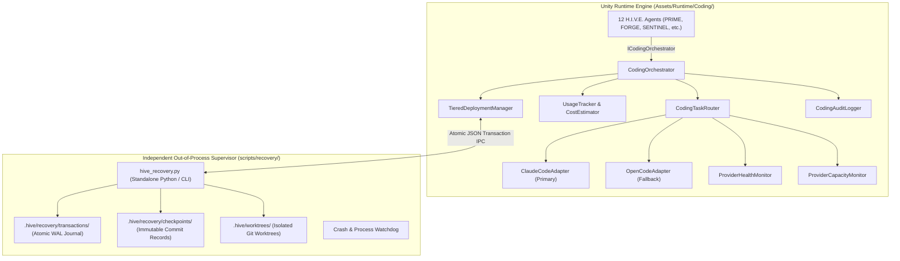
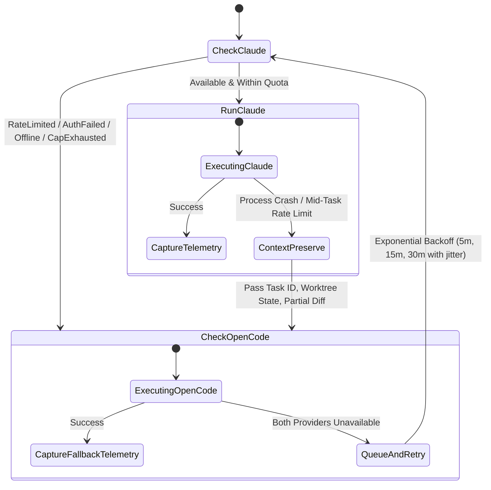
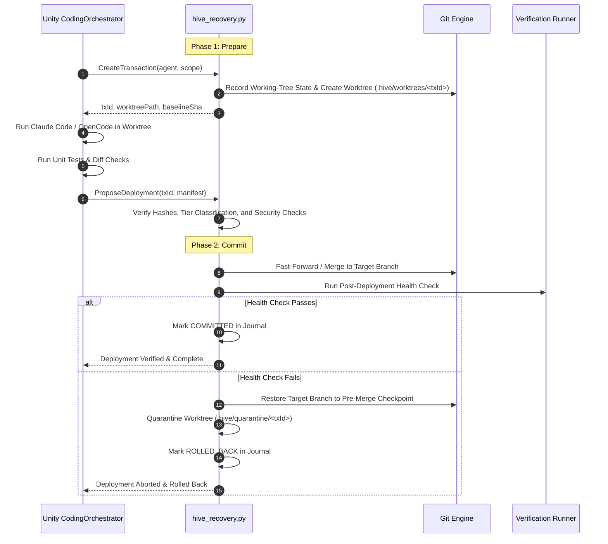

# Technical Specification: Claude Code + OpenCode Autonomous Development System

**Document Version:** 1.0.0  
**Date:** 2026-10-31  
**Author:** Snapwave//Lushapps (Pair Programmed with Antigravity)  
**Status:** Approved  
**Target Environment:** Unity 6000.6.7f1 LTS (URP) / .NET Standard 2.1 / Windows 64-bit  

---

## 1. Executive Summary & Objective

The **Claude Code + OpenCode Autonomous Development System** establishes a dedicated, enterprise-grade Coding Orchestration Layer for the 12 permanent agents of H.I.V.E. It enables the agency to autonomously inspect, debug, optimize, test, document, and extend its own source code and assets.

The system uses **Claude Code CLI** as its primary development engine and **OpenCode CLI** as its automatic free fallback. It enforces a strict **Tiered Autonomy Deployment Policy** backed by an **Out-of-Process Recovery Supervisor** running independently of Unity. Crucially, the recovery mechanism operates outside the agency's self-modifying boundary: H.I.V.E. can modify its application code without ever destroying or compromising its ability to restore known-good states.

---

## 2. System Architecture & Boundaries

The architecture maintains an absolute separation of concerns across two distinct execution planes:



### 2.1 Component Responsibilities

| Component | Execution Plane | Responsibilities |
| :--- | :--- | :--- |
| `ICodingOrchestrator` / `CodingOrchestrator` | Unity Runtime | Unified entry point for all 12 agents; task queueing, state persistence, lifecycle management. |
| `CodingTaskRouter` | Unity Runtime | Evaluates provider availability, dispatches tasks, manages mid-task context handoff on failover. |
| `ClaudeCodeAdapter` | Unity Runtime | Wraps `claude.exe` CLI; streams stdout, extracts structured JSON telemetry, classifies exits. |
| `OpenCodeAdapter` | Unity Runtime | Wraps `opencode` CLI; handles free model selection and prompt translation. |
| `ProviderHealthMonitor` | Unity Runtime | Tracks provider states: `Available`, `Unavailable`, `RateLimited`, `AuthFailed`, `UsageExhausted`, `Recovering`, `Disabled`. Distinguishes temporary vs permanent faults. |
| `UsageTracker` & `CostEstimator` | Unity Runtime | Tracks input, output, cached tokens, and USD costs. Strictly separates measured telemetry from heuristic estimates. |
| `TieredDeploymentManager` | Unity Runtime | Evaluates touched paths; classifies transactions into Tier 1 (Auto), Tier 2 (Owner Gated), or Tier 3 (Prohibited). |
| `CodingAuditLogger` | Unity Runtime | Streams audit records to `MessageBus`, `Repository`, and immutable local logs. |
| `hive_recovery.py` / `hive_recovery.cmd` | External Supervisor | Independent Python script. Creates isolated Git worktrees, records SHA-256 manifests, executes two-phase atomic deployments, monitors crashes, and guarantees rollback without depending on Unity. |

---

## 3. Tiered Autonomy Deployment Policy

The system classifies every modification based on a strict **fail-closed** path policy. If any touched file belongs to a higher tier, the entire transaction is elevated.

### 3.1 Policy Matrix

| Tier | Name | Target Paths & Criteria | Deployment Rules |
| :--- | :--- | :--- | :--- |
| **Tier 1** | **Autonomous Deployment** | • `Assets/Runtime/UI/Styles/**`<br>• `Assets/Runtime/Skills/**` (non-privileged)<br>• `Assets/Runtime/Voice/**`<br>• `docs/**`<br>• `README.md`<br>• `tests/**` (routine unit fixtures) | Auto-merges and deploys only when:<br>1. Isolated worktree tests pass 100%.<br>2. Dynamic baseline test count is matched/exceeded.<br>3. Static security diff check passes.<br>4. Deployment health checks succeed. |
| **Tier 2** | **Owner Approval Required** | • `Assets/Runtime/Core/**`<br>• `Assets/Runtime/Coding/**`<br>• `Assets/Runtime/Security/**`<br>• `Assets/Runtime/Persistence/**`<br>• `Assets/Runtime/LLM/**`<br>• `Assets/Scenes/**`<br>• `ProjectSettings/**`<br>• `Packages/manifest.json`<br>• `.github/workflows/**`<br>• Agent permission schemas<br>• *Any unknown or unclassified path* | 1. Prepared in isolated worktree.<br>2. Tests pass and diff report is generated.<br>3. Transaction is placed in `STAGED_AWAITING_APPROVAL`.<br>4. Requires explicit Owner authorization via Owner Control chamber UI or CLI (`hive approve <txId>`). |
| **Tier 3** | **Prohibited from Self-Modification** | • `scripts/recovery/**`<br>• `.hive/recovery/**`<br>• Emergency rollback mechanisms<br>• Direct removal of Owner controls or audit logs | Hard rejection by recovery supervisor. Agents cannot modify or deploy these files. Only the Owner can perform manual maintenance on recovery infrastructure. |

---

## 4. Provider Orchestration & Resilient Failover

### 4.1 Orchestration State Machine



### 4.2 Failover & Context Preservation Rules
1. **Isolated Worktree Ownership**: All changes are written directly into an isolated worktree (`.hive/worktrees/<txId>`).
2. **Graceful Process Termination**: Before failing over from Claude Code to OpenCode, the failed process is cleanly terminated and isolated to ensure no concurrent modification of the same worktree.
3. **Context Injection**: When invoking OpenCode after a partial Claude Code attempt, OpenCode is supplied with:
   - Original task objective and constraints.
   - Summary of completed sub-actions.
   - Current Git diff of the worktree.
   - Any compiler or test errors encountered.
4. **Token & Telemetry Hierarchy**:
   - Level 1: Exact provider telemetry (API metadata / CLI structured JSON).
   - Level 2: CLI-reported token summaries.
   - Level 3: Model-specific BPE tokenizer.
   - Level 4: Character heuristic (~4:1) flagged as `isMeasured: false`.
   - Cached input tokens are tracked separately and not double-counted as new consumption.

---

## 5. Safe Change Protocol & Out-of-Process Recovery Supervisor

### 5.1 Two-Phase Transactional Deployment

Every modification follows a two-phase transactional lifecycle managed by `hive_recovery.py`:



### 5.2 Transaction Journal Disk Schema (`.hive/recovery/transactions/<txId>.json`)

Transactions use write-ahead logging (WAL) via temporary files and atomic replacements:

```json
{
  "txId": "tx-20261031-1850-forge-001",
  "version": "1.0",
  "agent": "FORGE",
  "status": "COMMITTED",
  "createdAt": "2026-10-31T18:50:30Z",
  "completedAt": "2026-10-31T18:52:10Z",
  "baselineCommit": "333fc95a4f7831f478a8738bdc054238e55e090a",
  "candidateCommit": "a1b2c3d4e5f6...",
  "targetBranch": "master",
  "worktreePath": ".hive/worktrees/tx-20261031-1850-forge-001",
  "manifestHash": "sha256-e3b0c44298fc1c149afbf4c8996fb92427ae41e4649b934ca495991b7852b855",
  "provider": "ClaudeCode",
  "model": "claude-3-7-sonnet",
  "telemetry": {
    "isMeasured": true,
    "inputTokens": 4120,
    "outputTokens": 890,
    "cachedTokens": 1540,
    "estimatedCostUsd": 0.024
  },
  "tierClassification": {
    "tier": 1,
    "reason": "Non-sensitive UI layout and skill script updates",
    "touchedFiles": [
      "Assets/Runtime/UI/Styles/HiveHUD.uss"
    ]
  },
  "verification": {
    "baselineTestCount": 16,
    "worktreeTestCount": 16,
    "testsPassed": true,
    "diffSafetyPassed": true,
    "postDeploymentHealthPassed": true
  },
  "approval": {
    "required": false,
    "authorizedBy": "AUTONOMOUS_POLICY",
    "timestamp": "2026-10-31T18:52:00Z"
  }
}
```

### 5.3 Working-Tree Safety & Uncommitted User Change Protection
1. **Never Blindly Reset**: The supervisor captures `git status --porcelain` before creating any worktree.
2. **Worktree Isolation**: Coding CLIs operate exclusively inside `.hive/worktrees/<txId>/`. The main working tree is never touched during task execution.
3. **Reconciliation**: If uncommitted user modifications exist on the target branch at deployment time, the supervisor refuses to fast-forward automatically, alerts the Owner, and keeps the candidate staged in the worktree.

### 5.4 Independent Crash Watchdog
- `hive_recovery.py watchdog` runs as an independent daemon or CLI check during `hive doctor` and boot.
- It scans `.hive/recovery/transactions/` for transactions in `STAGED`, `VALIDATING`, or `DEPLOYING` states without a `COMMITTED` marker.
- It inspects the actual Git ref log, terminates orphaned CLI processes, and if a broken merge occurred, restores the branch to `baselineCommit` while preserving user changes and moving failed worktrees to `.hive/quarantine/`.

---

## 6. Detailed C# Runtime Architecture

```text
Assets/Runtime/Coding/
    Abstractions/
        ICodingOrchestrator.cs
        ICodingCliAdapter.cs
        IRecoverySupervisor.cs
        IUsageTracker.cs
        ITieredDeploymentManager.cs
        CodingModels.cs
    Orchestration/
        CodingOrchestrator.cs
        CodingTaskRouter.cs
        CodingTaskQueue.cs
        CodingTaskPersistence.cs
    Providers/
        ClaudeCodeAdapter.cs
        OpenCodeAdapter.cs
        ProviderHealthMonitor.cs
        ProviderCapacityMonitor.cs
    Usage/
        UsageTracker.cs
        TokenEstimator.cs
        CostEstimator.cs
        UsageHistory.cs
    Deployment/
        TieredDeploymentManager.cs
        DeploymentValidator.cs
        DeploymentCoordinator.cs
    Audit/
        CodingAuditLogger.cs

scripts/recovery/
    hive_recovery.py
    hive_recovery.cmd
    recovery_config.json
```

### 6.1 Role-Based Responsibilities of the 12 Agents

All 12 agents share `ICodingOrchestrator`, but their permissions and operational roles remain strictly defined by their agent schemas and `SecurityGate`:
- **PRIME**: Reviews Tier 2 proposals; authorizes deployment escalations.
- **FORGE**: Primary author of code, bug fixes, refactoring, and build tooling.
- **SENTINEL**: Performs mandatory static diff security audits, credential leak scans, and permission boundary validation.
- **GAUGE**: Runs unit test verification, regression suite benchmarks, and test fixture authoring.
- **SAGE / ARCHIVIST**: Generates documentation updates and indexes code patterns into `MemoryStore`.
- **SPARK**: Prototypes experimental modules in isolated worktrees.
- **CONDUCTOR**: Schedules and prioritizes coding task queues.
- **LEDGER**: Monitors usage limits, tracks token quotas, and enforces budget caps.

---

## 7. Verification & Acceptance Criteria

1. **Adapter Execution**:
   - `ClaudeCodeAdapter` executes tasks against `claude.exe`, capturing streaming logs and structured usage.
   - `OpenCodeAdapter` executes tasks against `opencode`, providing verified free fallback.
2. **Resilient Failover**:
   - Simulating rate-limits or offline states on Claude Code automatically transitions task execution to OpenCode without loss of worktree progress.
3. **Supervisor Isolation**:
   - `hive_recovery.py` runs independently from terminal/batchmode; creates isolated worktrees and logs atomic WAL journals.
4. **Tiered Policy Enforcement**:
   - Tier 1 modifications merge autonomously upon 100% test pass.
   - Tier 2 modifications enter `STAGED_AWAITING_APPROVAL`.
   - Tier 3 modifications are hard-rejected.
5. **Rollback & Health Check**:
   - Inducing an intentional build/test failure in a candidate worktree triggers an automatic rollback with zero impact on the master branch.
6. **E2E Integration Suite**:
   - Full test suite via `hive.cmd test` passes with zero regressions.

---

## 8. Author Sign-off

- **System Architect:** Snapwave//Lushapps  
- **Autonomous Agent:** Antigravity  
- **Approved by:** Owner  
